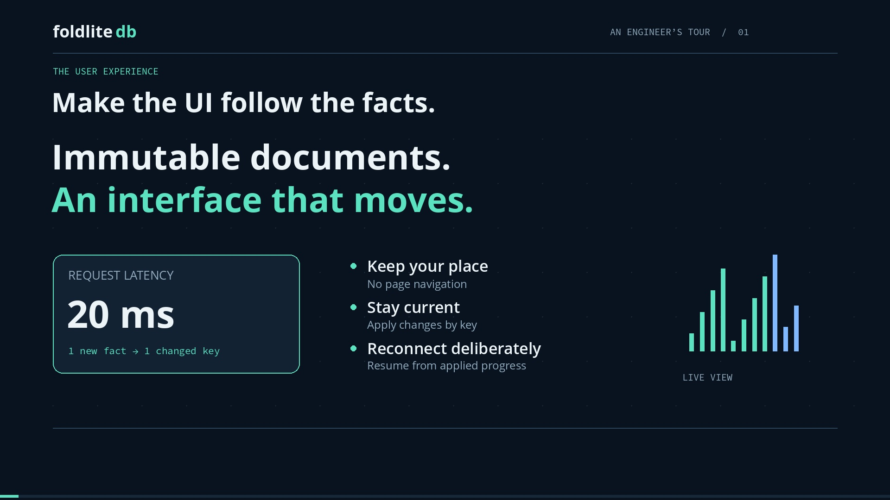

# Foldlite DB: from immutable facts to a live web UX

[Watch the video](foldlitedb-streaming-ux.mp4) · [Captions](foldlitedb-streaming-ux.vtt) · [Chapters](chapters.json) · [Narration source](story.json)



A 5 minute 44 second, 1080p narrated engineering walkthrough. Covers map/group/reduce,
incremental state, snapshot and change pagination, SSE document delivery,
disconnect/reconnect, portable Wasm, cache reconstruction, stable identities,
ordered catalogue folds, and current architectural boundaries. English captions
are burned in, included as a selectable MP4 subtitle track, and supplied as SRT
and WebVTT. The MP4 also contains chapter markers.

The demo images come from real Chromium running the repository's bundled
`metrics.wasm` inside `BrowserDatabase`'s worker. Diagram motion is illustrative;
the video makes no latency or throughput measurement claim. Narration is
synthetic, generated locally with Piper's LJ Speech voice. Sources and font
licenses are in [assets/credits.json](assets/credits.json).

## Run the working demo

From the repository root, with the repository's native extension built (see the
root README's source installation instructions):

```sh
python -m venv videos/streaming-ux/.venv
videos/streaming-ux/.venv/bin/python -m pip install -r videos/streaming-ux/requirements.txt
videos/streaming-ux/.venv/bin/python -m pip install .
videos/streaming-ux/.venv/bin/python -m playwright install chromium
videos/streaming-ux/.venv/bin/python videos/streaming-ux/demo.py
```

Open `http://127.0.0.1:8765`. Click **New observation**, pause the connection,
publish more observations, and reconnect. The fixture has six new observations
after its seven-document bootstrap. Restart the server to reset it. On Windows,
use `.venv\Scripts\python.exe` in place of `.venv/bin/python`.

This is an application example with a bounded, scripted input. Its localhost
HTTP server is a recording fixture. The document stream's integer cursor and
HTTP routes belong to this example, rather than the FoldliteDB public API.
The stream contains documents; the browser worker computes the view locally.
The native snapshot/change API is demonstrated separately in the video and
verified by the capture command. Native view cursors and document delivery
cursors have different lifecycles.

## Verify and render

```sh
videos/streaming-ux/.venv/bin/python videos/streaming-ux/demo.py --capture
videos/streaming-ux/.venv/bin/python videos/streaming-ux/render.py
```

Capture runs the actual SSE connection, asserts that latency changes from 20 to
19.5 while checkout remains 100, disconnects at document cursor 9, publishes
three unseen observations, and reconnects through cursor 12 before resuming live
delivery. It also checks complete browser/native state parity, browser replay,
paged native changes, identical named retries, recovery after cache loss,
expired-cursor rejection, and unchanged source-log bytes. It fails on browser
page errors. Captures and the detailed report go into ignored `.build/demo/`.

The renderer downloads a checksummed Piper voice once (about 109 MiB), then
synthesizes narration and renders locally using Pillow and the FFmpeg bundled
by `imageio-ffmpeg`. It needs no API keys. Fonts are included with their licenses.
Audio snippets are cached by sentence and synthesis settings. Editing
`story.json` and rerunning regenerates the timing, video, poster, captions, and
chapters. Rendering rebuilds these committed deliverables; review the resulting
diffs. Synthesis and encoding can vary across runtimes; regeneration is not
promised to produce byte-identical media.

To review stills without encoding the movie:

```sh
videos/streaming-ux/.venv/bin/python videos/streaming-ux/render.py --audio-only
videos/streaming-ux/.venv/bin/python videos/streaming-ux/render.py --preview
```

The contact sheet is `.build/storyboard.jpg`. Full-resolution scene stills and
intermediate audio/video remain in `.build/`; only the finished movie and small
viewer assets are committed.

## Technical sources in this checkout

- [README](../../README.md) and [design](../../DESIGN.md): durability, cache identity, ordered replay, limits.
- [Metrics view](../../views/assembly/examples/metrics.ts): map, explicit reducer state, finalization.
- [Catalogue view](../../views/assembly/examples/catalogue.ts): ordered lifecycle events.
- [Browser client](../../src/foldlitedb/portable_assets/client.js): worker ownership, query, changes, ingest, replay.
- [Streaming helper](../../src/foldlitedb/streaming.py): watermark replay, duplicate suppression, bounded queues, gap frames.
- [Telemetry example](../../examples/telemetry.py): snapshot pagination, complete change postimages, cursor recovery.

The example server intentionally implements only its finite fixture's document
transport. The streaming chapter describes `streaming.py`'s richer helper
contract; the capture verifies the browser and native view paths exercised by
the demo, rather than claiming to exercise that helper.
